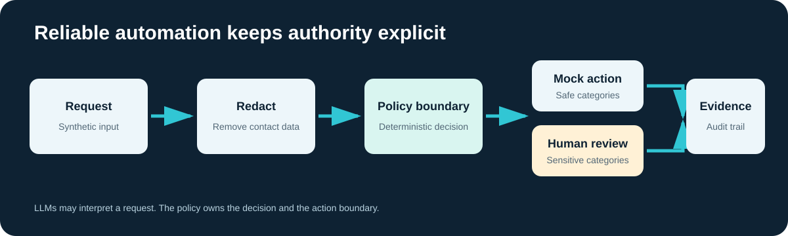
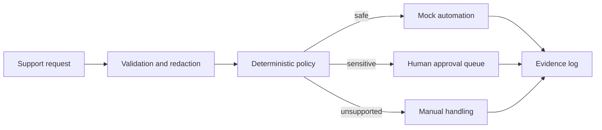

# Reliable Customer Operations Automation

A small, fully synthetic demonstration of the architecture patterns I use for reliable business automation: deterministic routing, AI-assisted decisions behind a boundary, idempotent execution, human approval, and an evidence trail.



This repository contains no production credentials, customer records, proprietary portal code, or client-specific configuration. It is an independent demo derived from patterns used in real automation work.

## Why this exists

Customer operations teams receive repetitive requests such as invoice retrieval, quota changes, billing questions, and account updates. Some requests can be automated safely. Others need an explicit approval or must remain manual.

The demo shows how to:

- classify a request without allowing an LLM to execute side effects;
- require human approval for sensitive operations;
- prevent duplicate processing with an idempotency key;
- redact contact details from the evidence log;
- produce a reviewable record for every decision.

## Architecture



An LLM can propose a category or extract structured fields before the policy step. The policy remains deterministic and owns the final routing decision.

## Run the demo

Python 3.10 or newer is sufficient. The project has no runtime dependencies.

```bash
python -m automation_demo.demo
python -m automation_demo.simulation --count 100
python -m unittest discover -s tests -v
```

If the package is not installed, set `PYTHONPATH=src` before running those commands.

## Repository map

- `src/automation_demo/engine.py`: routing, idempotency, redaction, and evidence.
- `src/automation_demo/demo.py`: executable example using synthetic requests.
- `src/automation_demo/simulation.py`: deterministic batch simulation and JSON report.
- `sample_data/requests.json`: fictional inputs.
- `workflows/n8n-reference.json`: an importable reference workflow with a policy boundary and approval branch.
- `tests/test_engine.py`: tests for approval boundaries, duplicate prevention, and redaction.
- `docs/CASE_STUDY.md`: design choices and production considerations.
- `.github/workflows/test.yml`: continuous validation on Python 3.10, 3.11, and 3.12.

## Example batch result

The committed example uses a deterministic generator and 100 synthetic requests:

| Decision | Count |
|---|---:|
| Automate | 50 |
| Require approval | 30 |
| Manual | 20 |

These numbers describe the included synthetic scenario. They are not customer performance claims.

See [`docs/example-report.json`](docs/example-report.json) for the machine-readable output.

## Container run

```bash
docker build -t reliable-operations-demo .
docker run --rm reliable-operations-demo
```

## Deliberate limits

The repository does not connect to a ticketing, billing, banking, or identity system. The action layer is a mock. A production deployment would add authenticated connectors, durable storage, metrics, retries with backoff, secret management, and operational runbooks.

## Author

Marc Oliver — AI Automation Architect, Funhelps  
Barcelona, Spain · [LinkedIn](https://www.linkedin.com/in/marc-oliver-ai/) · [Funhelps](https://funhelps.com)

